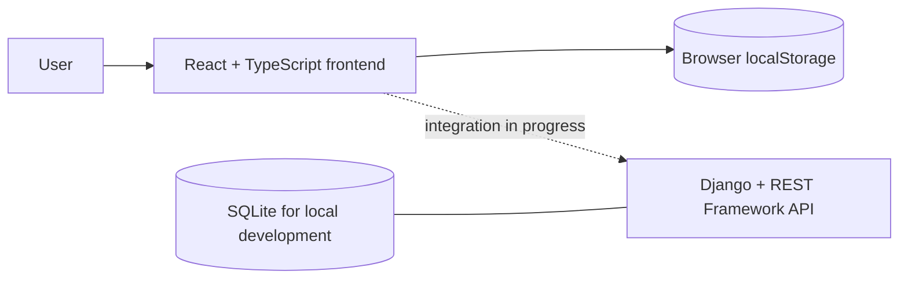

# Planner

<p align="center">
  
</p>

<p align="center">
  <strong>A modern, local-first personal planning application.</strong>
  <br />
  Built with React, TypeScript, Python, and Django.
</p>

<p align="center">
  
  
  
</p>

---

## Overview

Planner is a personal planning web application designed to help organize tasks, manage time, and track progress through a modern web interface.

The project combines a React and TypeScript frontend with a Django backend and a SQLite database for local development.

**Current focus:** a usable local-first frontend, with backend integration and broader validation still in progress.

## Tech Stack

<p align="center">
  <a href="https://skillicons.dev">
    
  </a>
</p>

### Technologies

| Technology | Purpose |
|---|---|
| React | Frontend user interface |
| TypeScript | Type-safe frontend development |
| Vite | Frontend development and build tooling |
| Python | Backend programming language |
| Django | Backend web framework |
| Django REST Framework | REST API development |
| SQLite | Local development database |
| Git | Version control |

## Architecture



The frontend currently stores planner data in the browser. The Django API and database are part of the repository, but end-to-end frontend/backend integration should not be assumed complete.

### Feature status

| Feature | Current status |
|---|---|
| Tasks | Add, edit, complete, filter, categorize, prioritize, and set due dates |
| Focus timer | 25-minute timer with pause and resume |
| Calendar | Monthly view of tasks with due dates |
| Habits | Create habits and track completed days |
| Notes | Create and manage personal notes |
| Reports | Summaries calculated from saved task data |
| Languages | Persian (RTL) and English (LTR) |
| Theme | Light and dark modes |
| Persistence | Browser localStorage for frontend data |
| Backend | Django REST Framework project included; integration needs separate validation |

## Getting Started

### Prerequisites

Install the following tools before running the project:

- Python
- Node.js and npm
- Git

### 1. Clone the repository

```bash
git clone https://github.com/amirreza91-13/planner.git
cd planner
```

### 2. Set up the backend

Create a Python virtual environment:

```bash
python -m venv venv
```

Activate it in Windows PowerShell:

```powershell
.\venv\Scripts\Activate.ps1
```

Install the Python dependencies:

```bash
pip install -r requirements.txt
```

### 3. Configure environment variables

Set a secure Django secret key and appropriate local development settings before running the backend.

Do not commit private environment files or real credentials to Git.

### 4. Apply database migrations

```bash
python manage.py migrate
```

### 5. Start the Django server

```bash
python manage.py runserver
```

The development server normally runs at:

http://127.0.0.1:8000/

### 6. Set up the frontend

Open a second terminal:

```bash
cd frontend
npm install
npm run dev
```

Vite will display the local frontend URL in the terminal.

If the frontend cannot communicate with the backend, verify the API endpoint and the development CORS configuration.

## Development

### Backend checks

```bash
python manage.py check
```

### Frontend production build

```bash
cd frontend
npm run build
```

## Security

- Never commit `.env` files, API keys, passwords, or private credentials.
- Never use Django's development-only secret key in production.
- Keep `DEBUG` disabled in production.
- Configure `ALLOWED_HOSTS` for the actual deployment environment.
- Keep local databases, logs, backups, and generated files out of the public repository.
- Review dependencies and configuration before deployment.

## Project Status

Planner is currently under development.

The architecture and features may evolve as development continues. Refer to the repository for the current implementation.

## Roadmap

- [ ] Improve the planning interface
- [ ] Expand task and time-management workflows
- [ ] Improve API integration
- [ ] Add automated tests
- [ ] Improve setup and developer documentation

## Author

**Amirreza Mirhaj**

- GitHub: [@amirreza91-13](https://github.com/amirreza91-13)
- LinkedIn: [Amirreza Mirhaj](https://www.linkedin.com/in/amirreza-mirhaj-490250435/)

---

<p align="center">
  <sub>Built incrementally with a focus on maintainability, usability, and continuous learning.</sub>
</p>